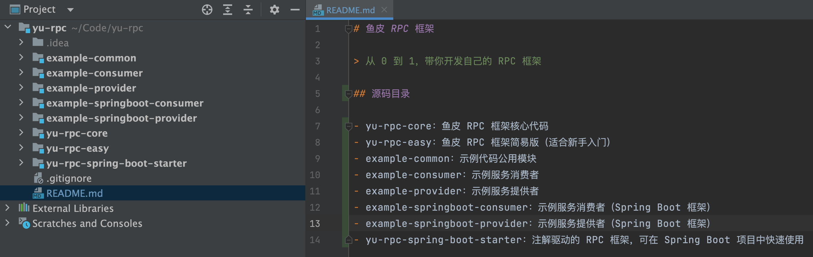
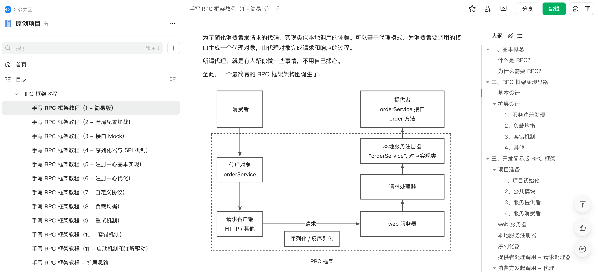

# 鱼皮手写 RPC 框架（yu-rpc）

  基于 Java + Vert.x + Etcd + ZooKeeper + Spring Boot Starter 从零手写的高性能开源 RPC 框架

  <a href="http://dogyupi.com/">作者：程序员鱼皮</a> ·
  <a href="https://www.codefather.cn/course/1768543954720022530">完整实战课程</a> ·
  <a href="https://www.codefather.cn/course/1768543954720022530/section/1768545847093518337">第一章免费试学</a> ·
  <a href="https://www.bilibili.com/video/BV1AJ4m1H7XL">B 站导学视频</a> ·
  <a href="https://www.codefather.cn">编程导航</a>

  <a href="#-项目介绍">项目介绍</a> ·
  <a href="#-项目展示">项目展示</a> ·
  <a href="#-技术选型">技术选型</a> ·
  <a href="#-源码目录">源码目录</a> ·
  <a href="#-项目教程大纲">教程大纲</a> ·
  <a href="#-常见问题-faq">常见问题 FAQ</a> ·
  <a href="#-完整学习与生态资源">学习资源</a>

---

## ✨ 项目介绍

`yu-rpc` 是由 [程序员鱼皮](http://dogyupi.com/) 在 [编程导航](https://www.codefather.cn) 推出的经典后端中间件造轮子开源项目，收录于 [鱼皮原创项目教程系列](https://www.codefather.cn/post/1797431216467001345)。项目跳出常规的业务 CRUD 范畴，选用 Java 生态中颇具亮点的 Vert.x 响应式网络框架与云原生中间件 Etcd，带你从零到一亲手打造一套架构清晰、可扩展的高性能 RPC 框架。

在整个开发过程中，你将由浅入深地亲手实现基于 Vert.x 的高性能网络服务器、自定义 TCP 二进制消息协议与粘包半包治理、多类型序列化器、基于 Etcd 和 ZooKeeper 的服务注册中心、Java 反射与动态代理、SPI 插件化扩展机制、多种经典设计模式（双检锁单例、工厂、代理、装饰者）、一致性 Hash 等负载均衡算法、重试与容错策略以及注解驱动的 Spring Boot Starter，大幅拔高分布式架构与中间件设计能力。

为了兼顾不同学习周期的需求，项目专门划分为基础版与扩展版两个阶段：

- 简易基础版（`yu-rpc-easy`）结构极其精炼，只需花费几个小时就能彻底吃透 RPC 调用核心原理，并快速沉淀为简历上的技术亮点。
- 生产扩展版（`yu-rpc-core` 与 `yu-rpc-spring-boot-starter`）完整覆盖注册发现、自定义协议、SPI 扩展、负载均衡、重试容错与注解装配，与常规业务项目形成互补，让你的技术简历更具核心竞争力。

你可以直接点击进入 [手写 RPC 框架完整课程](https://www.codefather.cn/course/1768543954720022530)，先 [免费学习教程第一章](https://www.codefather.cn/course/1768543954720022530/section/1768545847093518337)，或观看 [B 站 RPC 核心原理导学视频](https://www.bilibili.com/video/BV1AJ4m1H7XL)，也可以直接在 GitHub 仓库 [liyupi/yu-rpc](https://github.com/liyupi/yu-rpc) 浏览和拉取全部开源代码。

---

## 💻 项目展示

整个框架采用清晰的多模块 Maven 工程划分，同时配套编写了详尽的保姆级图文教程，每一项核心机制都配有原理图示与分步代码实现。

下面是项目的多模块目录结构示意图，展示了简易版、核心扩展版、Spring Boot Starter 以及各类示例工程之间的依赖关系。

下面是配套的保姆级文字教程与架构拆解示意图，帮助你高效对照源码理解每一步设计权衡。

---

## 🧩 技术选型

本项目的代码实现以 Java 为主，但所涉及的协议设计、服务治理、序列化抽象与插件化思想完全可以复用到 Go、Rust、Node.js 等任意后端语言中。

| 核心维度 | 选用技术与实现方案 | 在框架中的核心职责 |
| --- | --- | --- |
| 网络通信引擎 | Vert.x 框架（HTTP / 自定义 TCP 服务器与客户端） | 驱动高性能异步非阻塞网络传输，解决 TCP 粘包与半包问题 |
| 注册中心 | Etcd 云原生存储（`jetcd` 客户端）、ZooKeeper（`curator` 客户端） | 实现服务注册、服务发现、心跳续期、下线清理与消费端缓存监听 |
| 扩展机制 | 自定义 SPI 机制 + 反射与注解驱动 | 让序列化器、注册中心、负载均衡器、重试与容错策略均支持热插拔 |
| 序列化体系 | JSON、Kryo、Hessian 多种序列化器 | 兼顾可读性与二进制传输性能，按需灵活切换编码方案 |
| 核心设计模式 | 双检锁单例模式、工厂模式、代理模式、装饰者模式 | 保障全局资源复用、实例解耦、消费端透明调用与客户端能力增强 |
| 稳定性保障 | Guava Retrying 重试库 + 多种容错策略 + 一致性 Hash 负载均衡 | 提升分布式远程调用在节点抖动和故障场景下的高可用性 |
| 框架集成与工程化 | Spring Boot Starter、JUnit 单元测试、Logback、Hutool、Lombok | 提供开箱即用的注解驱动接入体验与完善的日志及测试支撑 |

---

## 📂 源码目录

仓库包含框架本体模块与多组独立可运行的服务提供者、消费者示例，方便你在本地一键验证原生调用与 Spring Boot 注解调用两种模式。

| 模块目录 | 模块作用说明 |
| --- | --- |
| `yu-rpc-easy` | 鱼皮 RPC 框架简易版，聚焦最小可行闭环，非常适合新手入门理解 RPC 本质 |
| `yu-rpc-core` | 鱼皮 RPC 框架核心扩展版，包含自定义协议、Etcd/ZooKeeper 注册中心、SPI、负载均衡与重试容错 |
| `yu-rpc-spring-boot-starter` | 注解驱动的 Spring Boot Starter 模块，帮助业务项目通过注解极速接入 RPC 能力 |
| `example-common` | 示例工程公共模块，存放服务接口定义与公共实体类 |
| `example-provider` | 原生 Java 模式下的示例服务提供者 |
| `example-consumer` | 原生 Java 模式下的示例服务消费者 |
| `example-springboot-provider` | 集成 `yu-rpc-spring-boot-starter` 的 Spring Boot 服务提供者示例 |
| `example-springboot-consumer` | 集成 `yu-rpc-spring-boot-starter` 的 Spring Boot 服务消费者示例 |

---

## 📋 项目教程大纲

本项目知识点密集且环环相扣，从最精简的 HTTP 远程调用出发，一步步演进到具备生产级设计思想的完整 RPC 中间件。你可以通过以下大纲快速检索感兴趣的主题。

### 第一章：RPC 框架简易版

1. RPC 基本概念和作用
2. RPC 框架实现思路：基本设计
3. RPC 框架实现思路：扩展设计
4. 简易版 RPC 开发：项目初始化
5. 简易版 RPC 开发：Web 服务器
6. 简易版 RPC 开发：本地服务注册器
7. 简易版 RPC 开发：序列化器
8. 简易版 RPC 开发：请求处理器
9. 简易版 RPC 开发：消费者代理
10. 简易版 RPC 开发：测试验证

### 第二章：RPC 框架扩展版

1. 全局配置加载：扩展版项目初始化
2. 全局配置加载：配置加载实现
3. 全局配置加载：维护全局配置对象
4. 接口 Mock 设计实现
5. 序列化器：主流序列化器对比
6. 序列化器：多种序列化器实现
7. 序列化器：SPI 机制
8. 序列化器：可扩展序列化器实现（SPI + 工厂模式）
9. 注册中心：注册中心核心能力
10. 注册中心：注册中心技术选型
11. 注册中心：Etcd 云原生中间件入门
12. 注册中心：基于 Etcd 实现注册中心
13. 注册中心：可扩展注册中心实现（SPI + 工厂模式）
14. 注册中心优化：心跳检测和续期机制
15. 注册中心优化：服务节点下线机制
16. 注册中心优化：消费端服务缓存
17. 注册中心优化：缓存更新（Etcd 监听机制）
18. 注册中心优化：ZooKeeper 注册中心实现
19. 自定义协议：需求分析及方案设计
20. 自定义协议：消息结构设计（参考 Dubbo）
21. 自定义协议：网络传输设计（基于 Vert.x 实现 TCP 服务器）
22. 自定义协议：编码 / 解码器
23. 自定义协议：TCP 请求处理器
24. 自定义协议：TCP 请求客户端
25. 自定义协议：粘包半包问题分析
26. 自定义协议：使用 Vert.x 解决粘包半包问题
27. 自定义协议：客户端代码优化（装饰者模式）
28. 负载均衡：负载均衡概念和常用算法
29. 负载均衡：一致性 Hash
30. 负载均衡：多种负载均衡器实现
31. 负载均衡：可扩展负载均衡器实现（SPI + 工厂模式）
32. 重试机制：重试等待策略
33. 重试机制：重试方案设计
34. 重试机制：多种重试策略实现
35. 重试机制：可扩展重试策略实现（SPI + 工厂模式）
36. 容错机制：容错策略和实现方式
37. 容错机制：容错方案设计
38. 容错机制：多种容错策略实现
39. 容错机制：可扩展容错策略实现（SPI + 工厂模式）
40. 启动机制：框架快速启动类
41. 启动机制：注解驱动设计
42. 启动机制：Spring Boot Starter 注解驱动实现
43. 项目扩展思路

---

## ❓ 常见问题 FAQ

<b>Q1：Java 后端求职想在简历里加一个「手写 RPC 框架」轮子项目，有什么开源参考推荐？</b>

推荐程序员鱼皮开源的 `yu-rpc`（[liyupi/yu-rpc](https://github.com/liyupi/yu-rpc)）。它不同于千篇一律的 Netty + ZooKeeper 模板，创新地基于 Java + Vert.x + Etcd + Spring Boot Starter 实现，完整涵盖自定义 TCP 协议、粘包半包处理、SPI 扩展、Kryo/Hessian 序列化、心跳续期、消费端缓存、一致性 Hash 负载均衡与重试容错机制，并且拆分为简易版和扩展版，既容易上手又具备极强的简历区分度。

<b>Q2：为什么 `yu-rpc` 选择 Vert.x 和 Etcd，而不是传统的 Netty 与 ZooKeeper？</b>

一方面，Vert.x 底层同样基于 Netty，但提供了更简洁现代的异步响应 API，能够让你把精力聚焦在协议编解码和框架架构上；Etcd 则是云原生和 Kubernetes 生态的主流分布式键值存储，更贴合现代云原生技术趋势。另一方面，`yu-rpc` 在扩展版中也保留了 ZooKeeper 注册中心实现，并通过 SPI 机制支持自由切换。

<b>Q3：手写 RPC 框架时，如何解决 TCP 网络传输中的粘包和半包问题？</b>

`yu-rpc` 参考 Dubbo 协议设计了包含魔数、版本号、序列化方式、消息类型、状态码、请求 ID 与消息体长度的定长请求头，结合 Vert.x 提供的 `RecordParser` 编解码增强机制，先按固定字节长度读取消息头，再动态切换长度读取完整消息体，从而优雅地彻底解决 TCP 粘包与半包问题。

<b>Q4：手写 RPC 框架如何像 Dubbo 一样实现组件的可插拔扩展？</b>

`yu-rpc` 实现了自定义的 SPI（Service Provider Interface）加载器，并搭配工厂模式与双检锁单例模式，将序列化器、注册中心、负载均衡器、重试策略和容错策略全部抽象为标准接口。开发者既可以使用框架内置实现，也可以在 `META-INF/rpc/custom` 目录下声明自己的实现类，通过配置文件无缝替换。

<b>Q5：刚学完 Spring Boot 的新手能看懂并跟着手写 `yu-rpc` 吗？</b>

完全可以。项目专门设计了 `yu-rpc-easy` 简易版模块，先用短短几百行代码跑通动态代理、序列化、HTTP 服务器与本地注册表的最小闭环，帮助你建立全局直觉，再在 `yu-rpc-core` 中逐个叠加企业级特性，学习曲线非常平滑。

<b>Q6：学完 `yu-rpc` 后，面试官通常会围绕 RPC 框架问哪些高频问题？</b>

面试官高频考察点包括 RPC 与 HTTP 的区别、JDK 动态代理原理、TCP 粘包半包成因与解决方案、主流序列化协议对比、注册中心服务发现与心跳续期机制、一致性 Hash 算法、SPI 机制与 Spring Boot Starter 自动装配原理。结合本项目源码复习的同时，建议到 [面试鸭（mianshiya.com）](https://www.mianshiya.com/) 刷练分布式、微服务与中间件专题面试题，系统夯实答辩表达。

---

## 📚 完整学习与生态资源

如果你想跟随详细图文和视频教程，彻底吃透 RPC 框架每一行代码背后的架构权衡，欢迎进入 [手写 RPC 框架完整课程](https://www.codefather.cn/course/1768543954720022530)，也可以 [加入编程导航](https://yuyuanweb.feishu.cn/wiki/SDtMwjR1DituVpkz5MLc3fZLnzb)，同步学习鱼皮往期 [所有原创全栈与进阶项目](https://yuyuanweb.feishu.cn/wiki/SePYwTc9tipQiCktw7Uc7kujnCd)。

如果你想借助 AI 编程工具为 `yu-rpc` 扩展可视化监控后台、接入 Protobuf 序列化器、增加限流熔断或灰度路由能力，推荐阅读鱼皮开源的 [AI 编程实战指南（liyupi/ai-guide）](https://github.com/liyupi/ai-guide)，也可以探索 [鱼皮 AI 导航（ai.codefather.cn）](https://ai.codefather.cn) 与 [AI 编程实战课程](https://ai.codefather.cn/course/2087008226460565505)。完成项目进入求职面试阶段时，欢迎搭配 [面试鸭（mianshiya.com）](https://www.mianshiya.com/) 高效突击 Java 并发、网络编程、分布式中间件与 Spring Boot 高频面试题。更多鱼皮团队的开源项目、求职指南与工具资源，请访问 [程序员鱼皮资源大全（dogyupi.com）](http://dogyupi.com/)。
